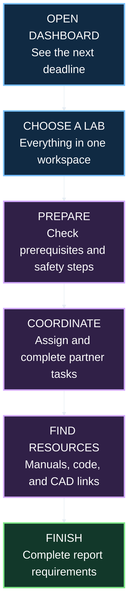
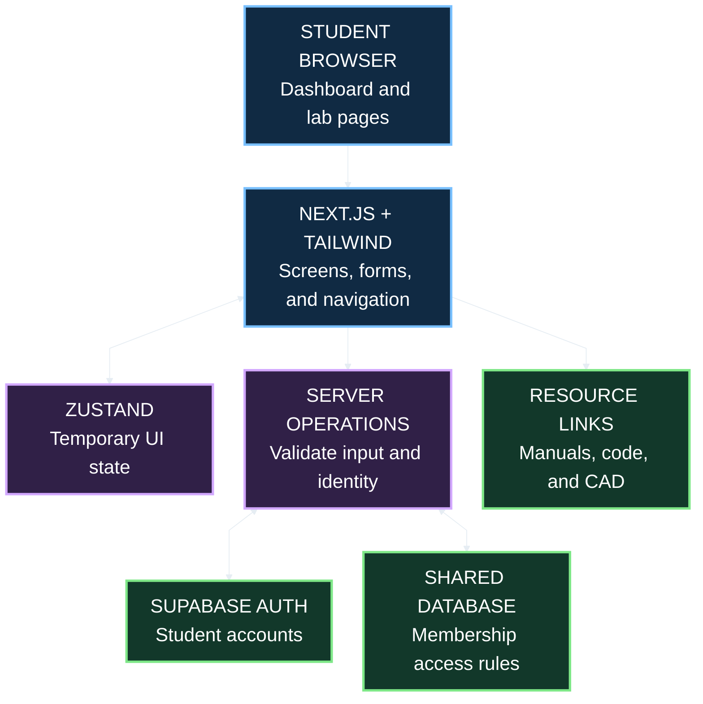
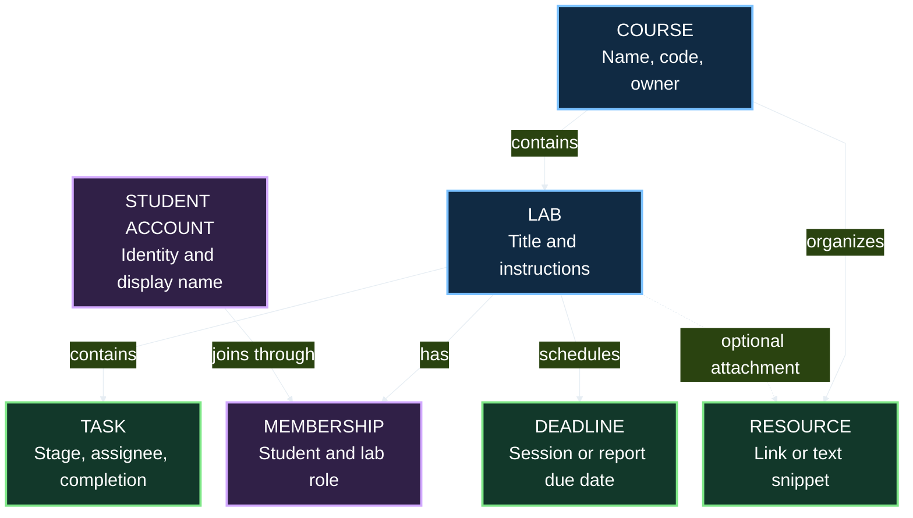
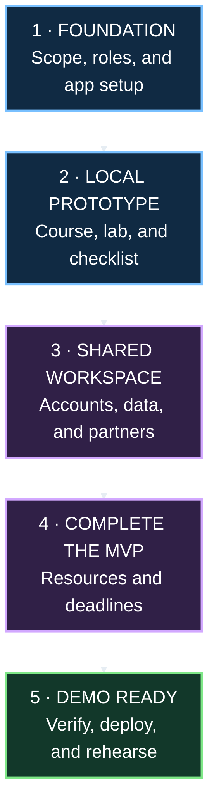

# LabBuddy · Project Plan

> **One dashboard. Every lab. Less last-minute stress.**
>
> A web app for engineering and computer science students to prepare for labs, divide partner tasks, organize resources, and track deadlines.

**Status:** Planning · **Audience:** Engineering and CS students · **Target:** A focused, working sprint demo

---

## 1 · The idea

Lab instructions, report requirements, partner messages, and resource files often live in different places. LabBuddy brings the work for each lab into one shared space so students can quickly answer:

- **What is due next?** See upcoming lab sessions and report deadlines.
- **Am I ready?** Finish prerequisites and pre-lab checklist items.
- **Who is doing what?** Assign tasks and see partner progress.
- **Where is that file?** Find manuals, code, and CAD resource links by course.

### The student experience

Read each diagram **from top to bottom**. Large labels, dark fills, and bright outlines are designed for GitHub dark mode. Text labels also explain each step without relying on color.

## 2 · The MVP: four features

| Feature | First working version | Done when… |
| :--- | :--- | :--- |
| **Lab task checklist** | Add, edit, complete, and delete pre-lab and post-lab tasks. Include prerequisite, safety, and report items. | Progress updates correctly, and saved tasks survive a refresh. |
| **Partner workspace** | Invite one partner to a lab, assign tasks, and show completion status. | Two signed-in students can access the same lab and see saved updates after refreshing. |
| **Course resource hub** | Save named links to manuals, code repositories, snippets, and CAD files under a course, optionally attached to a lab. | Students can add, open, edit, and remove resources from the correct course. |
| **Deadline tracker** | Show lab sessions and report due dates in a sorted agenda with overdue, today, and upcoming labels. | Dates sort correctly, and completed reports stop appearing as overdue. |

**Keep the first release small:** a dated agenda instead of a full calendar; resource links and text snippets instead of file uploads; saved updates visible on refresh instead of live synchronization.

**A local prototype is a milestone.** It can demonstrate the screens and checklist behavior, but real partner sharing requires accounts, a shared database, and access rules. Do not call a browser-only prototype a completed shared workspace.

### Later, after the MVP

- File uploads and previews.
- Notifications and calendar integrations.
- Live partner updates without refreshing.
- More than two students per workspace.
- Java or C++ tools tied to a specific course need.

## 3 · Technology choices

These are **proposed implementation choices**, not services already configured in this repository.

| Layer | Choice | Why it fits this project |
| :--- | :--- | :--- |
| App | Next.js App Router + TypeScript | Keep pages, layouts, and server operations in one project; use types for lab and task data. |
| Styling | Tailwind CSS + semantic HTML | Build a consistent, responsive dashboard with readable contrast and visible focus states. |
| Local UI state | Zustand | Manage filters, selected views, and temporary interaction state. |
| Shared persistent data | Supabase Postgres, proposed | Store courses, labs, memberships, tasks, resources, and deadlines centrally. |
| Accounts | Supabase Auth, proposed | Identify each student and connect them to the workspaces they can access. |
| Resource hosting | Existing external links for the MVP | Link to course manuals, GitHub code, and CAD resources without building an upload system. |
| Deployment | Vercel, proposed | Publish the Next.js demo when the core flows and access rules are verified. |

**Java and C++:** These match the team's coursework and can appear as resource content. The web MVP does not need separate Java or C++ backend services. Add executable tools only if a later feature has a clear need.

**Current comfort:** Java, C++, HTML, CSS, and basic Tailwind CSS.  
**Learning focus:** Next.js App Router, Zustand, shared data, and account access.

### How the pieces connect

**State rule:** The database owns saved shared records. Zustand owns temporary UI state; it does not become a second source of truth for partner tasks.

**Access rule:** Every shared read and write must verify lab membership. Database row-level security must enforce the same boundary. Keep privileged secrets out of browser code and Git.

## 4 · Pages and data

| Page | Main job |
| :--- | :--- |
| **Sign in** | Create an account, sign in, and sign out. |
| **Dashboard** | Show the next deadlines, active labs, and checklist progress. |
| **Course** | List course labs and shared course resources. |
| **Lab workspace** | Show pre-lab/post-lab tasks, assignees, partner membership, and report status. |
| **Deadlines** | Show a date-sorted agenda with course and status filters. |

### Data map

One course contains many labs. Each lab has an owner and at most one invited partner for the MVP. Course resources are visible to the course owner and members of labs in that course; a lab-specific resource is visible only to that lab's members.

**Data details to settle during setup:**

- Give every record a stable ID; use explicit course and lab references.
- Create owner membership when creating a lab. Only the owner can manage partner invitations.
- Invite an existing account by email for the first version. The invited student accepts before receiving access; email delivery is outside MVP scope.
- Assign tasks only to accepted lab members. Removing a partner removes their access and unassigns their tasks.
- Store deadline timestamps with timezone information and display them in the student's local timezone. Track report submission separately from checklist completion.
- Require a resource to contain a valid HTTP(S) URL or a text snippet. Do not execute saved code.
- Restrict course-wide resource editing to the course owner; lab members can manage resources attached to their own lab.

## 5 · Build order

**Use stages rather than invented calendar dates.** Set dates once the team size and sprint deadline are known. Complete each exit check before moving on.

| Stage | Work | Exit check |
| :--- | :--- | :--- |
| **1 · Foundation** | Confirm team roles and scope. Initialize Next.js, TypeScript, Tailwind, and Zustand. Establish dark theme, navigation, and shared types. Verify the repository remote and set up issues/branches. | App runs locally; everyone can explain the four MVP features and take an assigned issue. |
| **2 · Local prototype** | Build course and lab creation, checklist editing, progress, empty states, and local persistence. Seed clearly labeled fictional demo data. | One student can create a course and lab, complete tasks, and refresh without losing changes. |
| **3 · Shared workspace** | Configure accounts and schema. Move saved records to the database. Add membership rules, invitations, assignments, and access checks. | Two accounts share one lab; a third account cannot read or change it. Local prototype data has an explicit reset or migration path. |
| **4 · Complete the MVP** | Add resource links/snippets, session and report dates, submission status, agenda sorting, and filters. Connect dashboard summaries to real saved data. | All four MVP flows work together using shared persistent data. |
| **5 · Demo ready** | Resolve bugs, check keyboard/mobile use, verify access rules, document setup, deploy, and practice the pitch. | The demo script passes on the deployed app and the README explains how to run the project. |

## 6 · Team and collaboration

Names and strengths are **not yet decided**. These are responsibility areas, not assumed team members; combine them if the team is small.

| Responsibility | Main work | Owner |
| :--- | :--- | :--- |
| **Interface and accessibility** | Dashboard, navigation, theme, responsive pages, keyboard support | TBD |
| **Tasks and app state** | Checklist behavior, progress, forms, UI state | TBD |
| **Shared data and accounts** | Schema, sign-in, partner invitations, membership access | TBD |
| **Resources and delivery** | Resource hub, deadlines, integration checks, README, demo | TBD |

**Workflow:** Take one small issue, work on a feature branch, open a focused pull request, and ask a teammate to review before merging. Agree on shared data types before building separate screens. Each contributor verifies their own feature; one person coordinates the final demo.

**Repository status:** A local Git repository exists. Remote hosting and team access still need verification; the original proposal's “GitHub link coming soon” should be updated after that check.

## 7 · Risks and responses

| Risk | Practical response |
| :--- | :--- |
| **“Adding features” grows into too much work** | Finish one complete flow first, then add the next MVP feature. Put extras in a backlog. |
| **New App Router and Zustand concepts slow progress** | Build the local checklist prototype first. Write down which state belongs in the UI and which belongs in the database. |
| **Partner sharing is harder than it looks** | Introduce accounts and access rules before adding invitation polish. Verify the two-user flow early. |
| **One student can access another lab by changing an ID** | Enforce membership in server operations and database policies; verify with a separate nonmember account. |
| **Dates or progress labels are misleading** | Check overdue, today, future, timezone boundaries, and a submitted report separately from checklist status. |
| **Concurrent edits overwrite changes** | Save individual task changes instead of replacing whole lab records; surface failed saves and refresh current data. Live synchronization can follow later. |
| **A teammate cannot run the app** | Document environment variable names, setup commands, seed data, and database setup without committing secrets. |

**If time gets tight:** Cut uploads, notifications, live synchronization, and calendar polish first. If shared access cannot be completed, explicitly present a local prototype and record partner sharing as unfinished.

## 8 · Verification and definition of done

Use focused checks around behavior that can break the student workflow:

- [ ] Create, edit, complete, and delete a task; verify progress and persistence.
- [ ] Accept a partner invitation and assign a task; verify saved changes from both accounts after refresh.
- [ ] Confirm a pending invite and a nonmember account cannot access lab data, including through direct requests.
- [ ] Remove a partner; verify access ends and their assigned tasks become unassigned.
- [ ] Verify resource links/snippets stay under the correct course and lab, with the intended view/edit permissions.
- [ ] Check overdue, today, future, and submitted report states, including a timezone boundary.
- [ ] Handle empty lists, invalid forms, loading states, and failed saves with clear messages.
- [ ] Navigate core screens by keyboard and use them on a narrow mobile viewport.
- [ ] Pass the project's configured type checks, lint checks, focused behavior tests, and production build.
- [ ] Run the complete demo on the deployed app and document any known limitations.

## 9 · Pitch and demo

**Pitch:** “LabBuddy gives engineering and computer science students one place to prepare for labs, coordinate with a partner, and keep up with report deadlines.”

**Suggested three-minute demo:**

1. Open a dashboard with two fictional courses and an upcoming report deadline.
2. Enter a lab and complete a prerequisite checklist item.
3. Assign a report task to the partner; show the saved assignment from the partner account.
4. Open a linked manual or code resource from the course hub.
5. Mark a report as submitted and show the updated deadline view.

**Requested sprint workshops:**

- **Git and team collaboration:** Branches, focused pull requests, reviews, and resolving merge conflicts.
- **Pitching and demo skills:** Explain the problem, show the working student journey, and keep within the time limit.

## 10 · First actions

- [ ] Confirm team members, strengths, and responsibility owners.
- [ ] Confirm sprint deadline and assign dates to the five stages.
- [ ] Verify GitHub remote, repository visibility, and teammate access.
- [ ] Agree on the proposed authentication/database service before shared-workspace implementation.
- [ ] Turn the four MVP features and foundation work into small issues with exit checks.
- [ ] Start Stage 1, then build the course → lab → checklist flow.

---

> **Finish line:** A student and their partner can prepare a lab, divide its tasks, find course resources, and track the report deadline using saved shared data.
