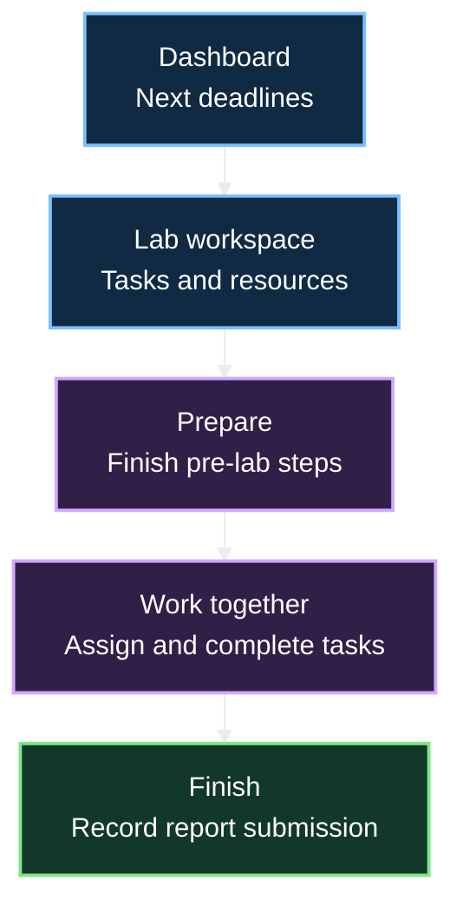
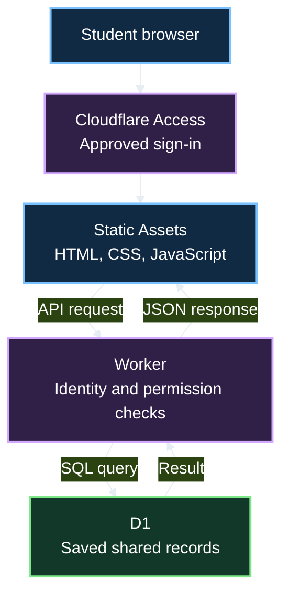
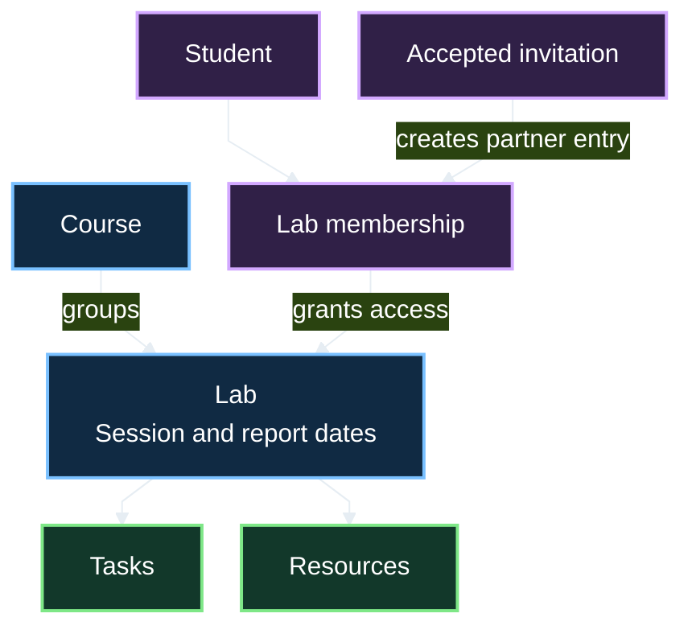
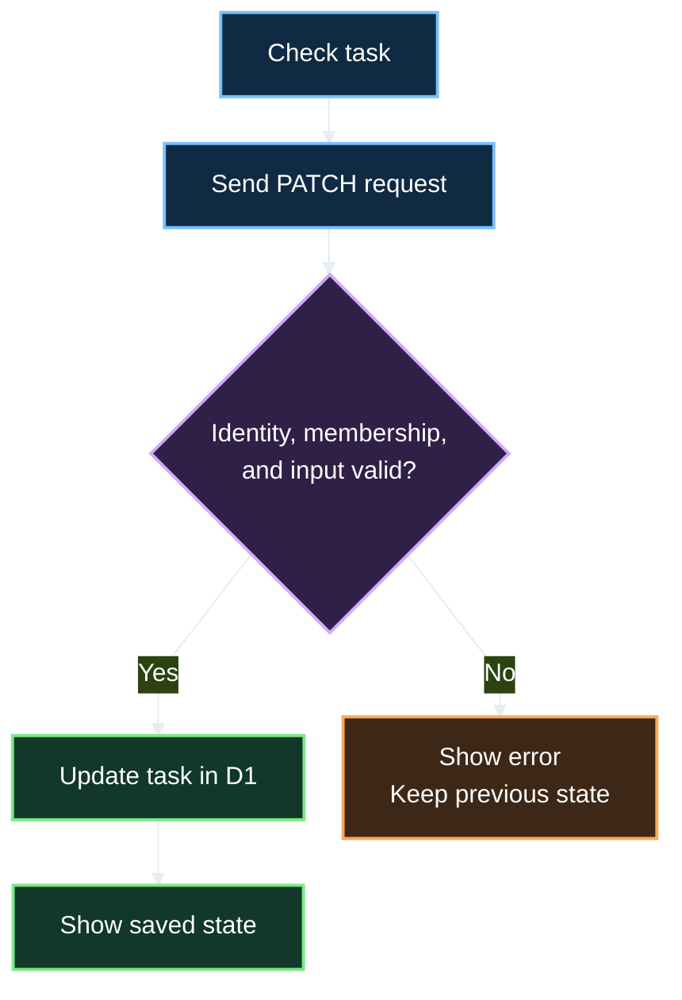
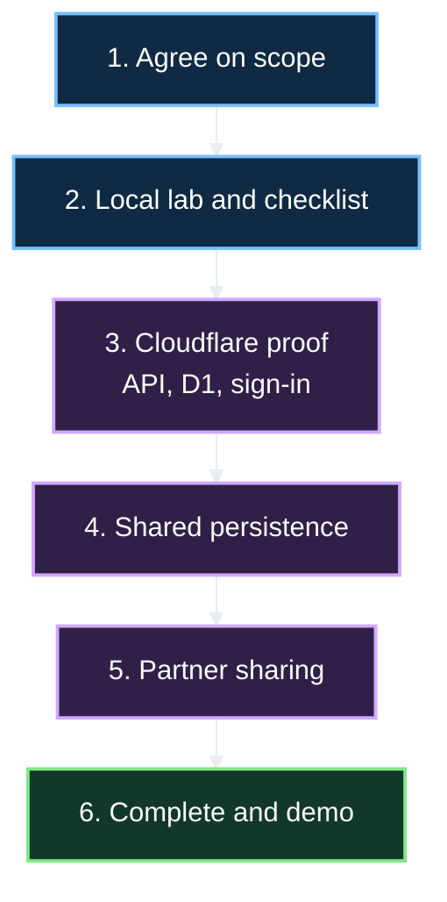

# LabBuddy · Team Project Plan

> **One dashboard for lab preparation, partner tasks, resources, and deadlines.**
>
> A manageable project for a second-year Ontario Tech Software Engineering team, building on Java, C++, and web programming coursework.

**Status:** Proposed plan; implementation has not started.

**Updated:** November 10, 2026.

**Recommended stack:** HTML, CSS, JavaScript, Cloudflare Workers, D1, and Access.

**Java:** An optional template tool, with a hosted-backend alternative explained below.

## 1 · Read this first

We want a working app that two students can use together. Build one complete workflow at a time: create a lab, add tasks, save the work, and share it with a partner.

Java and web programming are near final-exam stage, so this plan treats them as skills we can apply. We can check gaps as we work. Cloud deployment, SQL, and application permissions are the main new areas.

Diagrams use **16px text instead of 24px**, short labels, dark fills, and bright outlines. Each diagram explains one idea; tables provide the details.

| Decision | Plan |
| :--- | :--- |
| Website and server hosting | One Cloudflare Worker application, including Static Assets. |
| Shared database | Cloudflare D1. |
| Sign-in | Cloudflare Access with approved emails and one-time PIN login for a closed MVP. |
| Browser code | HTML, CSS, and JavaScript modules. |
| Java contribution | Optional checklist-template tool; Java Containers backend is a larger alternative. |
| Delivery strategy | Four features, small issues, and staged completion checks. |

These are proposed choices. No application code or Cloudflare resources have been created by this plan.

## 2 · Our coursework and what it means for this project

Ontario Tech's **2025–2026 and 2026–2027 Software Engineering maps** place ENGR 1200U in first-year winter and SOFE 2710U / SOFE 2800U in second-year fall. Data Structures follows in second-year winter; Data Management Systems comes later. We can use programming/web foundations now and treat SQL as a project learning goal. [2025–2026 map](https://shared.ontariotechu.ca/shared/faculty/feas/documents/25-26-program-maps/software-engineering-2025-2026.pdf), [2026–2027 map](https://shared.ontariotechu.ca/shared/faculty/feas/documents/26-27-program-maps/software-engineering-2026-2027.pdf).

**This is a planning inference, not a transcript assessment.** Maps establish course order, not individual mastery. Your description establishes that Java and web programming are near completion. The public academic calendar was inaccessible during research, so the exact current syllabus and weekly progress were not verified.

| Course / experience | Apply it here | Check or learn during the project |
| :--- | :--- | :--- |
| **ENGR 1200U · Introduction to Programming for Engineers** | Use your C++ experience to divide problems into functions, process collections, validate input, and debug. | JavaScript differences and browser events. |
| **SOFE 2710U · Object Oriented Programming and Design** | Model courses, labs, tasks, and students; divide responsibilities clearly. Apply Java OOP to the optional tool. | Connecting the same concepts across browser, API, and database. |
| **SOFE 2800U · Web Programming** | Apply the HTML, CSS, forms, and browser programming covered in your course. | Confirm confidence with modules, JSON, HTTP, and asynchronous requests before integration. |
| **Engineering design and lab experience** | Identify realistic prerequisites, partner duties, safety steps, and report requirements. | Turn needs into small features with observable completion checks. |

Ontario Tech's public OOP overview includes abstraction, encapsulation, classes, file I/O, debugging, and design diagrams. Those foundations help organize this app. The Java language experience itself is confirmed by you. [Official course overview](https://engineering.ontariotechu.ca/departments/ecse/software-engineering.php).

We do not need to wait for later courses. We need a few focused exercises for the new integration skills.

## 3 · Problem and student workflow

Lab details are scattered across portals, messages, folders, and repositories. LabBuddy should answer:

- What lab session or report deadline is next?
- Which preparation steps remain?
- Which tasks belong to me or my partner?
- Where are the manual, code, and CAD resources?



**Example:** In a fictional circuits lab, one student checks equipment and calculations; the partner prepares the report outline. Both use the same workspace. The report deadline stays visible until they record submission. LabBuddy records that status; it does not submit work to the university portal.

## 4 · Four features in the MVP

An **MVP** is the smallest version that delivers the main benefit and can be demonstrated reliably.

| Feature | First version | Completion check |
| :--- | :--- | :--- |
| **Lab checklist** | Create, edit, complete, and delete pre-lab/post-lab tasks. Show completed / total progress. | Progress updates correctly and saved tasks survive refresh. |
| **Partner workspace** | Share one lab with one accepted partner; assign tasks and show who completed them. | Two signed-in students see saved updates after refresh. A third cannot access the lab. |
| **Course resource hub** | Group resource links and text snippets by course. Each resource belongs to a specific lab. | Find the correct manual, repository, or CAD link from the lab or course view. |
| **Deadline tracker** | Save a session time and report due time; show an agenda with overdue/today/upcoming labels. | Dates sort correctly; a submitted report stops appearing as overdue. |

**Scope decisions:**

- Start with an agenda list; a calendar grid can follow later.
- Save links and snippets; file uploads can follow later.
- Refresh to see partner changes; live updates can follow later.
- Support an owner plus one partner per lab.
- Approve testers for the first shared release; public signup is a separate release.
- Course views include only labs the signed-in student owns or joined.

A local-storage prototype is a milestone. Real sharing needs a shared database and permissions; a single-browser prototype does not complete the partner feature.

## 5 · Cloudflare stack, explained

| Piece | What it means | Our use |
| :--- | :--- | :--- |
| **HTML + CSS** | Page structure and appearance. | Forms, checklist rows, navigation, responsive layout, and readable dark mode. |
| **JavaScript modules** | Browser behavior divided into small files. | Events, rendering, filters, and API calls. |
| **Workers Static Assets** | Cloudflare serves HTML, CSS, and browser scripts. | Host the interface alongside the API. [Docs](https://developers.cloudflare.com/workers/static-assets/). |
| **Cloudflare Worker** | Server code runs when a request arrives. | Handle API routes, validate requests, check permissions, and query D1. |
| **Cloudflare D1** | Managed database with SQLite SQL semantics. | Store shared records. [Overview](https://developers.cloudflare.com/d1/). |
| **Cloudflare Access** | Sign-in gate for approved users. | Admit the team and demo testers. [Workers integration](https://developers.cloudflare.com/workers/configuration/cloudflare-access/). |
| **Wrangler + npm** | Terminal tools for development and deployment. | Run locally, manage database changes, and deploy. Node.js supports tooling; it is not a separately hosted server. |
| **Git + GitHub** | Shared history, review, and issue tracking. | Small branches, pull requests, and signed commits. |

**Why simplify the original frontend stack?** A useful dashboard can be built with the team's current web skills. Next.js, React, Zustand, and TypeScript can be evaluated after the first release if the team wants them. Start with ordinary CSS; Tailwind remains an option if everyone can maintain it.

**Data rule:** D1 owns saved shared records. Browser variables own temporary selections and forms. After API integration, local storage is not a second copy of partner data.



## 6 · Where Java fits

Java and JavaScript are different languages. Our Java knowledge helps with modeling and tooling, but a normal Java program does not become a browser script or Worker by uploading it.

Cloudflare lists JavaScript, TypeScript, Python, and Rust as first-class Worker languages and offers further language options through WebAssembly. The recommended Worker uses JavaScript rather than adding a Java-to-WebAssembly toolchain. [Worker languages](https://developers.cloudflare.com/workers/languages/).

| Option | Concrete contribution | Extra learning | Fit |
| :--- | :--- | :--- | :--- |
| **Java template tool** | Local command-line app creates reusable lab checklist templates and exports JSON. | JSON export and an agreed file format; optional web import validation. | Useful optional Java contribution. |
| **Java backend on Cloudflare Containers** | A Java HTTP service runs in a container and is reached through a Worker. | Java web endpoints, Docker, container lifecycle, routing, and database integration. | Possible larger alternative after a proof of concept. |
| **JavaScript web MVP** | Deliver the four features with one browser/server language. | Workers, SQL, and Access integration. | Recommended sprint path. |

Containers can run applications requiring other runtimes, including a Java runtime packaged in an image. They currently require a Workers Paid plan; the documented setup also uses Docker. Check that route before adopting it. [Containers overview](https://developers.cloudflare.com/containers/), [setup requirements](https://developers.cloudflare.com/containers/get-started/).

**Optional Java deliverable:**

1. Model `LabTemplate` and `TemplateTask` using classes and a task collection.
2. Accept local input or built-in examples; reject empty titles and invalid stages.
3. Export a JSON file such as `circuits-template.json`.
4. If web import is added, preview its tasks before applying it to a lab.
5. Validate imported data again in the Worker and generate new IDs. The file cannot choose owners, memberships, or database IDs.

This connects Java OOP and file handling to a real feature. Keep web import outside the four-feature MVP unless time allows. The local tool needs no Cloudflare credentials.

If Java must power the deployed backend, prove one Java endpoint through Containers before committing to that architecture. Decide which service owns database operations; do not assume D1 provides an ordinary JDBC connection. That alternative changes scope and needs its own estimate.

## 7 · Sign-in and lab permissions

For the closed MVP, enable Access for the application, allow specific tester emails, and explicitly configure **one-time PIN** login. An approved student receives a code by email; we do not build a password database. [PIN setup](https://developers.cloudflare.com/cloudflare-one/integrations/identity-providers/one-time-pin/).

**Two checks have different jobs:** Access decides who may enter the app. Lab membership decides which lab records that person may use.

**Implementation notes for the teammate handling authentication:**

- Protect production and preview entry points.
- Validate the Access token before using identity. With Static Assets, use the documented `Cf-Access-Jwt-Assertion` validation pattern with `jose`; check signature, issuer, audience, and expiry.
- Associate the verified subject with a `users` record and save the verified email for invitations.
- Do not treat a browser-supplied email as proof of identity.
- Keep authenticated API responses private. Use same-origin requests and reject cross-origin state-changing browser submissions.

Cloudflare documents that Static Assets' internal router does not pass `ctx.access` to the user Worker. This is why the plan includes explicit token validation. [Identity limitations](https://developers.cloudflare.com/workers/configuration/cloudflare-access/#ctxaccess-limitations), [JWT validation](https://developers.cloudflare.com/cloudflare-one/access-controls/applications/http-apps/authorization-cookie/validating-json/).

**Partner flow:**

1. The owner creates a lab and receives owner membership.
2. The partner is approved in Access and signs in once to create an app profile.
3. The owner invites that existing account by verified email.
4. The invitee accepts; the server checks that a partner place is still available.
5. Both accepted members can manage tasks/resources and assign work to each other.
6. Only the owner removes the partner; removal ends lab access and clears their task assignments.

An in-app invitation does not add someone to Access. The teammate managing Access approves new testers separately. This is a closed demo design; public onboarding requires a later authentication decision.

**Local development:** Use fictional users selected by server-side local configuration for UI/database work. Keep that development identity path disabled in deployed environments; never let a public request choose its own identity. Test the real Access flow on the protected demo before calling sign-in complete.

## 8 · Screens and expected behavior

Use one application page with sections or hash navigation initially, keeping navigation and refresh behavior simple.

| Section | Content | Actions |
| :--- | :--- | :--- |
| **Dashboard** | Upcoming deadlines, active labs, progress | Open a lab; create a course/lab. |
| **Course** | Accessible labs and their resource links | Open a workspace; find resources. |
| **Lab workspace** | Tasks, assignees, partner, resources, dates | Manage work; invite partner; record report submission. |
| **Deadlines** | Sorted sessions and report due dates | Filter by course; open a lab. |
| **Invitations** | Invitations addressed to the current student | Accept or decline. |

Every list needs an empty state with a next action. Every save needs loading and failure handling. If saving fails, retain entered text and offer retry.

## 9 · Data model

A **table** stores one kind of record. An **ID** identifies a record. A **foreign key** links records. We will learn enough SQL to use these relationships safely.

| Table | Example fields | Job |
| :--- | :--- | :--- |
| `users` | `id, access_subject, email, display_name` | Profiles tied to verified identity. |
| `courses` | `id, owner_id, code, name` | Group the owner's labs. |
| `labs` | `id, course_id, title, notes, session_at, report_due_at, report_submitted_at` | Workspace and dates. |
| `lab_members` | `lab_id, user_id, role` | Owner and accepted partner. |
| `tasks` | `id, lab_id, title, stage, assignee_id, completed_at, completed_by` | Checklist and responsibility. |
| `resources` | `id, lab_id, title, type, url, snippet` | Links and text snippets. |
| `invitations` | `id, lab_id, invitee_id, status, created_at` | Invitations before membership. |



**Rules to agree on before coding:**

- Only a course owner creates labs under it. Lab creation also creates owner membership.
- Partners see the course name and joined labs, not every lab in that course.
- Prevent duplicate memberships. Enforce one owner and at most one partner with constraints and atomic invitation acceptance.
- Assign tasks only to accepted members. Assignment and completion are separate fields.
- Check membership for every lab/task/resource request, including direct requests using an ID.
- Use SQL parameters/prepared statements instead of joining user input into SQL strings.
- Store dates in UTC; display them in the browser's timezone. Missing dates stay missing.
- Record report submission separately from task completion.
- Save HTTP(S) links or plain-text snippets. Do not execute pasted code.

**Progress example:** 3 completed tasks out of 5 = 60%. Zero tasks displays “No tasks yet.”

## 10 · How a click becomes saved data

An **API** is the set of URLs the browser uses to ask the server for data or changes. **JSON** is the data format exchanged.

For a completed task:

1. Send `PATCH /api/tasks/task-id` with `{ "completed": true }`.
2. The Worker verifies identity, input, and membership in that task's lab.
3. Update only the intended task and return its saved state.
4. Update the checkbox and progress from that response. Show retry on failure.



### Initial API contract

Agree on request/response examples before building separate screens. These endpoints are proposed.

| Request | Job | Permission |
| :--- | :--- | :--- |
| `GET /api/me` | Read/create profile after verified sign-in | Approved signed-in user |
| `GET /api/courses` | Owned courses and summaries for joined labs | Filter to current user |
| `POST /api/courses` | Create course | Current user becomes owner |
| `GET /api/labs` | Accessible labs/dates for dashboard and agenda | Membership filter |
| `POST /api/courses/:id/labs` | Create lab and owner membership | Course owner |
| `GET /api/labs/:id` | Read lab, tasks, resources | Accepted lab member |
| `PATCH /api/labs/:id` | Update dates/submission status | Accepted lab member |
| `POST /api/labs/:id/tasks` | Add task | Accepted lab member |
| `PATCH /api/tasks/:id` / `DELETE /api/tasks/:id` | Edit, assign, complete, delete | Member of the task's lab |
| `POST /api/labs/:id/resources` | Add resource | Accepted lab member |
| `PATCH /api/resources/:id` / `DELETE /api/resources/:id` | Edit/remove resource | Member of the resource's lab |
| `POST /api/labs/:id/invitations` | Invite existing user | Lab owner |
| `GET /api/invitations` | List incoming invitations | Addressed invitee |
| `POST /api/invitations/:id/accept` or `/decline` | Respond | Addressed invitee |
| `DELETE /api/labs/:id/partner` | Remove partner/clear assignments | Lab owner |

Use consistent errors, such as `{ "error": "Task title is required" }`. Accept only intended writable fields; ordinary task edits cannot change owners or memberships.

## 11 · Suggested project layout

These files are proposed; they do not exist yet.

```text
LabBuddy/
  public/
    index.html              Website structure and sections
    styles.css              Shared styles and responsive layout
    js/
      app.js                Navigation and rendering
      api.js                Shared requests/error handling
      checklist.js          Task interactions
      resources.js          Links/snippets
      deadlines.js          Agenda/date display
  server/
    worker.js               API entry point
    auth.js                 Identity verification
    permissions.js          Membership/owner checks
    routes/                 Feature handlers
  migrations/
    0001_initial.sql        Tables, constraints, indexes
  seed/
    demo.sql                Fictional development records
  tools/java/               Optional template tool
  tests/                    Focused behavior/access tests
  wrangler.jsonc            Worker, assets, D1 configuration
  package.json              Development scripts/dependencies
  .dev.vars.example         Names and safe placeholders
  .gitignore                Ignore secrets/generated files
  PLAN.md                   Project plan
  README.md                 Setup/demo instructions to write later
```

Start with one Worker, one D1 binding called `DB`, and one static-assets directory. Route `/api/*` through the Worker; unknown API paths must not return the HTML page.

Keep local secrets in ignored files and production secrets in Cloudflare secret configuration. Use separate local and demo data. Administrative tokens never go into browser scripts.

## 12 · Build stages

Set dates once the team confirms available time and the sprint deadline. Each stage has a concrete exit check.



### Stage 1 · Agree on scope and contracts

- [ ] Sketch screens and select a fictional example lab.
- [ ] Assign responsibility areas and first issues.
- [ ] Agree on task fields, dates, endpoint responses, and naming.
- [ ] Check everyone's Node/npm, Git access, and terminal setup.
- [ ] Choose a Cloudflare account owner and authorized collaborators.

**Exit:** Every teammate can explain their first issue and its expected inputs/outputs.

### Stage 2 · Build the local workflow

- [ ] Build course/lab forms and the checklist.
- [ ] Add task edits, completion, deletion, and progress.
- [ ] Put persistence behind functions such as `listTasks()` and `saveTask()`.
- [ ] Use fictional local data; local storage is acceptable at this stage.
- [ ] Handle empty titles, zero tasks, keyboard use, and narrow screens.

**Exit:** Create a lab, complete tasks, and refresh without losing local work. Clearly label this a single-browser prototype.

### Stage 3 · Prove Cloudflare integration early

- [ ] Serve a static page and test API response with Wrangler.
- [ ] Create a local D1 binding/migration; read and update one record.
- [ ] Deploy a demo database and Worker.
- [ ] Enable Access and approved-email PIN sign-in.
- [ ] Verify a real identity in the Worker and query the remote demo database.

**Exit:** An approved tester signs in and reads a saved demo record; an unapproved tester is blocked. Discover account/deployment issues here before the full UI depends on them.

A **migration** is a versioned SQL file changing database structure. Verify it locally before applying it remotely. [Migration guide](https://developers.cloudflare.com/d1/reference/migrations/).

### Stage 4 · Save the core workflow in D1

- [ ] Implement profile, course, lab, and task endpoints.
- [ ] Add validation, permission checks, and prepared SQL statements.
- [ ] Replace prototype persistence functions with API requests.
- [ ] Seed demo data separately; provide an explicit reset for prototype data.
- [ ] Add focused tests for saved tasks, denied access, and progress/date calculations.

**Exit:** The owner's lab persists across refresh and a second signed-in browser. An unrelated user cannot read it by ID.

### Stage 5 · Add partner sharing

- [ ] Add invitations to existing approved users, acceptance, and decline.
- [ ] Enforce the member limit even for simultaneous invitation acceptance.
- [ ] Assign tasks only to accepted members.
- [ ] Add owner-only partner removal and assignment cleanup.
- [ ] Save individual record changes rather than replacing whole labs.

**Exit:** Two members see each other's saved work after refresh. Pending invitees, removed partners, and unrelated users have the correct restricted access.

### Stage 6 · Finish and demonstrate

- [ ] Add resource links/snippets and course grouping.
- [ ] Add session/report dates, submission status, agenda sorting, and filters.
- [ ] Check timezone display, empty states, errors, and retries.
- [ ] Verify mobile/keyboard use and write setup instructions.
- [ ] Rehearse the deployed demo; add Java tooling only if time allows.

**Exit:** All four features work together on the protected demo. Record any unfinished features honestly.

## 13 · Team responsibilities and Git workflow

Names and strengths remain undecided. These are areas of responsibility, not an assumption about team size. Combine areas for a smaller team; pair on unfamiliar database/access work.

| Area | Concrete work | Useful background | Owner |
| :--- | :--- | :--- | :--- |
| **Interface** | Forms, navigation, course/lab screens, responsive styles | HTML/CSS/browser programming | TBD |
| **Tasks and resources** | Checklist, progress, resource UI, API integration | Functions, objects, events | TBD |
| **Worker and D1** | Routes, SQL, migrations, permissions | Programming/debugging; SQL is new learning | TBD |
| **Access and delivery** | Sign-in, date behavior, verification, README, demo | Web programming and organization | TBD |
| **Optional Java tool** | Template classes, validation, export | Java OOP/file handling | TBD |

Everyone should be able to trace one action from browser to API to database. Avoid leaving sign-in and permissions understood by only one teammate.

1. Take a small issue with an observable completion check.
2. Use a focused branch, such as `feature/lab-checklist`.
3. Open a pull request with the resulting behavior and verification.
4. Ask a teammate to review; discuss data-contract changes before merging.
5. Merge when relevant checks pass and show the result to the team.

The repository is already on GitHub. Signing is configured on the current machine; teammates configure their own machines separately. Server-side signing enforcement depends on the owner's repository permissions and plan.

## 14 · Learning tasks and risks

| Topic | Small practice task | Ready when… |
| :--- | :--- | :--- |
| **JSON / asynchronous requests** | Send a form value to an endpoint and render its response. | Explain loading, success, and failure. |
| **Workers** | Handle one GET and POST. | Locate validation and response code. |
| **SQL / D1** | Add/read/update/delete a task; join it to membership. | Explain why one student may edit it and another may not. |
| **Access** | Sign in and verify identity on an API request. | Distinguish app admission from lab membership. |
| **Deployment** | Deploy a change and apply a migration to demo data. | Identify local versus remote data. |
| **Java export, optional** | Export a valid template. | A teammate can reproduce it from the instructions. |

| Risk | Practical response |
| :--- | :--- |
| Too many tools/features | Finish each stage and keep extras in the backlog. |
| Unfamiliar database/access work | Pair on a small proof before integrating the whole UI. |
| A student accesses another lab | Centralize membership checks; test direct API requests with another account. |
| Concurrent edits overwrite work | Update individual records/fields and surface failed saves. |
| Java delays the demo | Keep the tool independent; estimate Containers separately. |
| Dates or progress confuse users | Test zero tasks, UTC/local boundaries, and submitted reports. |
| Unexpected cloud cost/limits | Check current Workers/D1/Access limits during setup; review Containers before adoption. |

If time is tight, postpone uploads, notifications, live synchronization, Java import, and calendar polish. If sharing is unfinished, present the completed prototype accurately.

## 15 · Verification and demo

Use automated tests for important permissions and calculations, plus a manual student walkthrough. This document edit does not require application tests; these checks guide implementation.

- [ ] Create/edit/complete/delete tasks; verify progress and persistence.
- [ ] Check zero, some, and all completed tasks.
- [ ] Reject missing, forged, and expired identity tokens.
- [ ] Deny lab access to pending invitees and unrelated users, including direct API requests.
- [ ] Accept an invite and verify saved changes from two browsers.
- [ ] Prevent simultaneous acceptance from creating a third member.
- [ ] Remove a partner; verify access and assignment cleanup.
- [ ] Keep course/resource results limited to accessible labs.
- [ ] Validate links/snippets and retain entered text after failed saves.
- [ ] Check overdue/today/future, missing dates, timezone boundaries, and submitted reports.
- [ ] Navigate by keyboard and on a narrow viewport.
- [ ] Run configured checks and a deployment dry run, then repeat core flows on the deployed demo.

**Three-minute demo:**

1. Explain the scattered-information problem.
2. Sign in and open a dashboard with two fictional courses.
3. Complete a preparation task and show progress.
4. Assign a partner task; refresh the partner browser to show it.
5. Open a manual or code resource.
6. Record report submission and show the updated deadline status.

**Pitch:** “LabBuddy helps engineering students prepare for labs, coordinate with a partner, and keep report deadlines visible in one shared workspace.”

**Requested workshops:** Git/team collaboration and pitching/demo skills. A Workers + D1 introduction would also help this implementation.

## 16 · First team meeting

- [ ] Confirm names, strengths, deadline, and available work sessions.
- [ ] Agree on the recommended Cloudflare MVP or explicitly choose the larger Java backend route.
- [ ] Assign first issues and reviewers.
- [ ] Agree on the example lab and API/data contract.
- [ ] Select the Cloudflare account owner and approved testers.
- [ ] Schedule the early deployment/database/sign-in proof.
- [ ] Record decisions so absent teammates can catch up.

**Finish line:** Two approved students can prepare a lab, divide tasks, find resources, and track the report deadline using saved shared data, while another student cannot access their lab.
